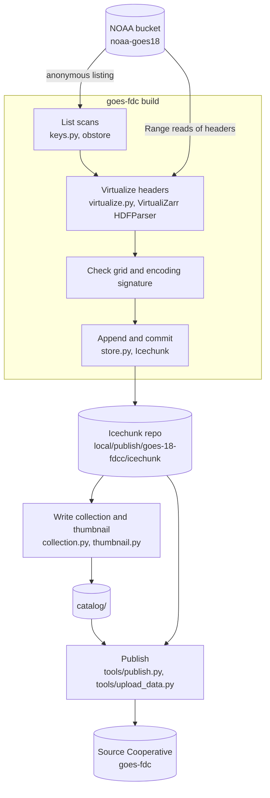

# Architecture and methods

This document describes how the catalog is built and why.
[catalog/README.md](../catalog/README.md) describes the data. The
[repository README](../README.md) describes how to run the pipeline. The
pipeline code is in `pipeline/`, and the published catalog is in `catalog/`.

## Summary

The catalog publishes NOAA's GOES ABI Fire/Hot Spot Characterization (FDC) as a
Portolan catalog. Each collection is a **virtual Zarr cube** in an Icechunk
repository. The cube references byte ranges in NOAA's netCDF files and copies no
pixel data. We run no server. Everything we host is static files on Source
Cooperative.

The method is similar to Earthmover's
[GOES-16 virtual Zarr work](https://www.earthmover.io/blog/virtual-zarr/). This
design applies it to the FDC product and uses a Portolan catalog as the
discovery layer.

The catalog is a Zarr test case for
[portolan-spec#132](https://github.com/portolan-sdi/portolan-spec/issues/132),
which defers a normative Zarr profile until real Zarr datasets have been tested
in catalogs. Zarr stays outside Portolan's conformance surface.
[Zarr in Portolan: findings from this demo](#zarr-in-portolan-findings-from-this-demo)
collects what this catalog found.

## Goals and non-goals

Goals:

- Never copy the dataset.
- No always-on server. Readers hit static files only.
- Stay appendable. The cube starts with a fixed time range and can extend to
  real time.
- Lay out the catalog so other satellites and sectors can be added as sibling
  collections, with no change to an existing URL.

Non-goals for this version:

- COG, GeoParquet or tile derivatives.
- Products other than FDC.
- Any claim of Portolan conformance for the Zarr asset.

## Source data

NOAA writes one netCDF4 (HDF5) file per scan. GOES-18 FDCC files are under
`s3://noaa-goes18/ABI-L2-FDCC/<YYYY>/<DDD>/<HH>/`. Each file name contains the
scan mode and the scan start, scan end and creation times.
`pipeline/src/goes_fdc/keys.py` parses these names.

The variables, grid and codes are described in
[catalog/README.md](../catalog/README.md). The measured file layout is in the
[collection agent guide](../catalog/goes-18-fdcc/AGENTS.md).

## Build method

`goes-fdc build --start ... --end ...` runs the steps in the `goes-fdc build`
box one UTC day at a time. A long build has only one day in memory, and a
stopped build resumes at the next day.

**Listing.** The bucket listing is the index, so there is no separate indexer or
database. The build lists one hour prefix at a time and starts after the last
`time` value in the store. A second run over the same window adds nothing.

**Virtualization.** VirtualiZarr reads the HDF5 metadata of each file with Range
requests and records the byte range of each chunk. It reads no pixel chunks. The
cube keeps NOAA's variables, chunks and attributes as they are.

**Time.** The build takes each scan's time from the file, and falls back to the
file-name stamps when the file value is not usable.

**One grid per cube.** A virtual cube inherits the grid and encoding of the
files it references, and NOAA changes these over a satellite's life. The build
records a signature of the grid and encoding of each scan. It stops when a scan
does not match the store. Scans with a different signature belong in a separate
cube.

**Writing the store.** Each UTC day is one Icechunk commit, so a failed day
commits nothing and the next run retries it. The repository authorizes NOAA's
bucket as a virtual chunk container. It splits manifests along `time` by day, so
an append writes only the new day's manifests.

**Writing the catalog metadata.** `goes_fdc.collection` writes `collection.json`
from facts it reads from the store: extent, grid, variables and projection. The
metadata cannot drift from the data, because the data is its only input.

## The Zarr store

Each collection's asset is an Icechunk repository. Its chunks are byte ranges in
NOAA's files, so a reader must authorize NOAA's bucket as a virtual chunk
container. The tested recipe is in the
[collection README](../catalog/goes-18-fdcc/README.md#access). A generic Zarr
client that does not know Icechunk cannot open the store by URL.

**Change detection.** Each virtual reference records the time it was written.
Icechunk sends that time with every chunk read, and NOAA's bucket refuses the
read if the file changed after that time. The check is by time, not by content,
so a re-upload of identical bytes also stops the read. It works only against a
server that supports conditional reads, as S3 does.

## Verification

- **Read-back.** All five variables of sampled scans read back byte-identical to
  the raw netCDF.
- **Append.** A repeated run over the same window adds no scans, and the time
  axis remains unique and monotonic.
- **Reading over HTTP.** A clean environment with only `icechunk`, `zarr` and
  `xarray` opens the store over HTTP and returns the same values as a local
  read.
- **Change detection.** NOAA's bucket refuses a read of a file that changed
  after the reference was written. A server without conditional reads returns
  the changed file with no error.
- **Validation.** `rashid check catalog --schema` reports no errors. The
  warnings are in [conformance.md](conformance.md).

## Zarr in Portolan: findings from this demo

This section collects what this catalog found as a test case for
[portolan-spec#132](https://github.com/portolan-sdi/portolan-spec/issues/132).

Gaps in the catalog metadata:

- **The virtual chunk container.** The chunks are in NOAA's bucket, not next to
  the store. Icechunk reads them only after the reader authorizes that bucket,
  and no STAC field says so. The collection README gives the recipe instead.
- **That the store is Icechunk.** The asset media type says Zarr. It does not
  tell a client that it needs the `icechunk` library.
- **Which snapshot to open.** An Icechunk repository has branches and tags, and
  no metadata field says which one a reader should open.
- **Which grid era a cube covers.** One satellite can need more than one cube
  for its whole record. No field states the era of a cube or links the cube for
  another era.
- **Checksum and size of a directory asset.** The `icechunk` asset is a
  directory, so it has no one checksum or size. The validator warns about it.

What worked:

- **Discovery.** pystac walks the catalog with no special handling. The asset
  gives enough to call `xarray.open_zarr` once the store is open.
- **Projection.** The projection on the asset is enough to convert a longitude
  and latitude box to scan angles with `pyproj` alone.

Lessons from building a virtual store:

- **Split manifests from the start.** Without splitting, each append rewrites
  every manifest, and the repository grows with the square of the number of
  commits.
- **An archive is not one grid.** Compare a signature of each scan against the
  cube, and stop on a mismatch.
- **Check the headers.** A virtual cube copies header values, so a bad header
  value becomes a bad coordinate with no error.
