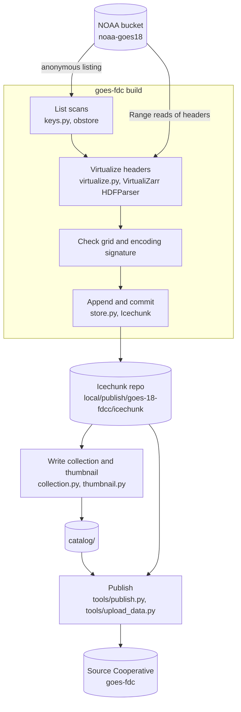

# Architecture and methods

This document describes how the catalog is built and why.
[catalog/README.md](../catalog/README.md) describes the data. The
[repository README](../README.md) describes how to run the pipeline. The
pipeline code is in `pipeline/`, and the published catalog is in `catalog/`.

## Summary

The catalog publishes NOAA's GOES ABI Fire/Hot Spot Characterization (FDC) as a
Portolan catalog. Each collection is a **virtual Zarr cube** in an Icechunk
repository. The cube references byte ranges in NOAA's netCDF files and copies no
pixel data. We run no server. Everything we host is static files on Source
Cooperative.

The method is similar to Earthmover's
[GOES-16 virtual Zarr work](https://www.earthmover.io/blog/virtual-zarr/). This
design applies it to the FDC product and uses a Portolan catalog as the
discovery layer.

The store follows the GeoZarr conventions and the proposed Portolan Zarr
profile wherever a virtual store can.
[Specifications and conventions](#specifications-and-conventions) lists what it
follows. The catalog is a Zarr test case for
[portolan-spec#132](https://github.com/portolan-sdi/portolan-spec/issues/132),
which defers a normative Zarr profile until real Zarr datasets have been tested
in catalogs. Zarr stays outside Portolan's conformance surface.
[Answers to portolan-spec#132](#answers-to-portolan-spec132) gives this
catalog's evidence for each open question.

## Goals and non-goals

Goals:

- Never copy the dataset.
- No always-on server. Readers hit static files only.
- Stay appendable. The cube starts with a fixed time range and can extend to
  real time.
- Lay out the catalog so other satellites and sectors can be added as sibling
  collections, with no change to an existing URL.

Non-goals for this version:

- COG, GeoParquet or tile derivatives.
- Products other than FDC.
- Any claim of Portolan conformance for the Zarr asset.

## Source data

NOAA writes one netCDF4 (HDF5) file per scan. GOES-18 FDCC files are under
`s3://noaa-goes18/ABI-L2-FDCC/<YYYY>/<DDD>/<HH>/`. Each file name contains the
scan mode and the scan start, scan end and creation times.
`pipeline/src/goes_fdc/keys.py` parses these names.

The variables, grid and codes are described in
[catalog/README.md](../catalog/README.md). The measured file layout is in the
[collection agent guide](../catalog/goes-18-fdcc/AGENTS.md).

## Build method

`goes-fdc build --start ... --end ...` runs the steps in the `goes-fdc build`
box one UTC day at a time. A long build has only one day in memory, and a
stopped build resumes at the next day.

**Listing.** The bucket listing is the index, so there is no separate indexer or
database. The build lists one hour prefix at a time and starts after the last
`time` value in the store. A second run over the same window adds nothing.

**Virtualization.** VirtualiZarr reads the HDF5 metadata of each file with Range
requests and records the byte range of each chunk. It reads no pixel chunks. The
cube keeps NOAA's pixel variables, chunks and CF attributes as they are. It also
keeps NOAA's projection variable and NOAA's per-scan summary values, which are
header values, not pixels.

**Time.** The build takes each scan's time from the file, and falls back to the
file-name stamps when the file value is not usable.

**One grid per cube.** A virtual cube inherits the grid and encoding of the
files it references, and NOAA changes these over a satellite's life. The build
compares each scan with the store on standard metadata only. It compares the
`proj` and `spatial` root attributes. It also compares each array's chunks,
data type, fill value, codecs and CF scaling, and it stops on any difference. Scans with a
different grid belong in a separate collection.

**Incomplete files.** A file without one of the pixel variables gets an array
with no chunk references for that scan, so a read returns the fill value. A file
whose start and end stamps are equal is kept with the file-name midpoint as its
time, unless its fire mask is all fill values. That check is the only pixel read
in a build.

**Writing the store.** Each UTC day is one Icechunk commit, so a failed day
commits nothing and the next run retries it. The repository authorizes NOAA's
bucket as a virtual chunk container. It splits manifests along `time` by day, so
an append writes only the new day's manifests.

**Writing the catalog metadata.** `goes_fdc.collection` writes `collection.json`
from facts it reads from the store: extent, grid, variables and projection. The
metadata cannot drift from the data, because the data is its only input.

## The Zarr store

Each collection's asset is an Icechunk repository with a Zarr v3 group at its
root:

- The pixel variables are virtual `time` × `y` × `x` arrays. Their chunks are
  byte ranges in NOAA's files.
- NOAA's per-scan values are `time` arrays: fire pixel counts, outlier counts,
  and the minimum, maximum, mean and standard deviation of fire temperature,
  area and radiative power.
- `goes_imager_projection` holds NOAA's CF projection attributes. Each pixel
  variable names it in `grid_mapping`.
- The root attributes declare the `proj`, `spatial`, `stac` and `license`
  conventions.

A reader must authorize NOAA's bucket as a virtual chunk container. The tested
recipe is in the [collection README](../catalog/goes-18-fdcc/README.md#access).
A generic Zarr client that does not know Icechunk cannot open the store by URL.

**The grid for each kind of reader.** The CRS and the grid come from NOAA's
file and are written three times, once for each kind of reader:

| Reader | Where it looks | CRS | Grid |
|---|---|---|---|
| STAC clients | The STAC asset | `proj:wkt2` | `proj:transform` and `proj:shape`, in metres |
| GeoZarr clients | The store root attributes | `proj:wkt2` | `spatial:transform`, `spatial:shape` and `spatial:dimensions`, in metres |
| CF clients | Each array's `grid_mapping` | `goes_imager_projection` | `x` and `y`, in radians |

CF and NOAA define a geostationary grid's coordinates as scan angles in radians.
The geostationary CRS is in metres, which are the scan angle times the satellite
height. The metres are only in the fields whose standards define metres, so no
client converts units. The transform origin is the outer edge of the first
pixel, as in `stactools-goes`, which builds Planetary Computer's GOES items.

**Change detection.** Each virtual reference records the time it was written.
Icechunk sends that time with every chunk read, and NOAA's bucket refuses the
read if the file changed after that time. The check is by time, not by content,
so a re-upload of identical bytes also stops the read. It works only against a
server that supports conditional reads, as S3 does.

## Verification

- **Read-back.** All five variables of sampled scans read back byte-identical to
  the raw netCDF.
- **Append.** A repeated run over the same window adds no scans, and the time
  axis remains unique and monotonic.
- **Reading over HTTP.** A clean environment with only `icechunk`, `zarr` and
  `xarray` opens the store over HTTP and returns the same values as a local
  read.
- **Change detection.** NOAA's bucket refuses a read of a file that changed
  after the reference was written. A server without conditional reads returns
  the changed file with no error.
- **Conventions.** The root attributes validate against the published `proj`,
  `spatial`, `stac` and `license` JSON schemas and against
  [`geozarr-toolkit`](https://github.com/zarr-developers/geozarr-toolkit), the
  GeoZarr working group's validator.
- **Pixel placement.** `spatial:transform` with `proj:wkt2` places the corner and
  centre pixels at the same longitude and latitude as NOAA's published
  fixed-grid equations. The transform equals the `proj:transform` of Planetary
  Computer's GOES-18 CONUS `goes-cmi` items.
- **CF readers.** rioxarray finds the CRS through `grid_mapping` when the store
  is opened with `decode_coords="all"`, as `xarray:open_kwargs` states.
- **Validation.** `rashid check catalog --schema` reports no errors. The
  warnings are in [conformance.md](conformance.md).

## Specifications and conventions

| Specification | Status | How |
|---|---|---|
| Zarr v3 | Follows | Each snapshot is a Zarr v3 group |
| GeoZarr `proj` convention v0.1 | Follows | `proj:wkt2` in the root attributes. A geostationary grid has no EPSG code |
| GeoZarr `spatial` convention v0.1 | Follows | `spatial:dimensions`, `spatial:shape` and `spatial:transform` in the root attributes |
| GeoZarr `multiscales` convention v0.1 | Does not follow | A pyramid needs computed pixels, so a virtual store cannot have one |
| Zarr `stac` convention v0.1 | Follows | `stac:link` points to the collection |
| Zarr `license` convention v1 | Follows | `license` is `{"spdx": "CC0-1.0"}` |
| Zarr `CF` convention | Not registered | The CF attributes are present. The convention has no tagged release to register |
| CF conventions | Follows for the pixel variables | NOAA's CF attributes, with a `grid_mapping` that resolves |
| STAC 1.1 | Follows | rashid's schema check reports no errors. stac-check crashes on the collection, as [conformance.md](conformance.md) records |
| STAC extensions | Follows | `zarr`, `xarray-assets`, `datacube`, `projection`, `render` and `file` |
| STAC Zarr best practices | Follows | Media type `application/vnd.zarr; version=3`, a collection-level asset for the store group, variables in `bands`, and a `rel: store` link |
| Portolan core | Follows | The catalog and collection pass rashid with no errors |
| Proposed Portolan Zarr profile | Follows where a virtual store can | See [Answers to portolan-spec#132](#answers-to-portolan-spec132) |

The pipeline writes the convention attributes with
[`zarr-cm`](https://github.com/zarr-conventions/zarr-cm), the Zarr conventions
project's Python library. The GeoZarr v0.4 draft, which was CF-based, is
superseded by the conventions above. Its `GeoTransform` and `crs_wkt` attributes
are not written.

## Answers to portolan-spec#132

[portolan-spec#132](https://github.com/portolan-sdi/portolan-spec/issues/132)
lists four open questions and some scope items. The draft profile in
portolan-spec#128 excludes virtual and transactional stores from its first
version. This catalog is one of those stores, so it tests where the draft fits
them.

**Multiscale depth.** A virtual store has a depth of one. A coarser level needs
computed pixels, and those pixels are copied data. A minimum depth would
exclude every virtual store. An appendable store also pays for each level on
every append. So the profile should set no minimum depth, or exempt virtual
stores from `multiscales`.

**Statistics.** The collection has no computed statistics, because they change
with every append. The `render` hint gives a viewer a fixed display range for
fire radiative power. NOAA's own per-scan statistics are `time` variables in
the store. So statistics that belong to each time step are data, not
collection metadata. For a categorical variable such as the fire mask, a
minimum, maximum and mean have no meaning.

**STAC requirements.** A client needs these fields to open the store:

- `xarray:open_kwargs`, for the engine and the consolidation setting
- `zarr:node_type`, for a group or an array
- `proj:wkt2` with `proj:code` null, for a CRS that has no EPSG code
- `proj:transform` and `proj:shape`, for the grid in CRS units

The datacube fields describe the dimensions of a multi-variable cube better than
`bands` alone. This catalog writes both.

**Storage layout.** A virtual store cannot choose its chunks, shards or
compression. It inherits them from the source files. Here each read of one pixel
over time touches one 250 × 250 chunk per scan. So chunk and shard rules belong
in conversion guidance, not in conformance.

**Consolidated metadata.** The draft requires it. Icechunk has no consolidated
metadata, so an Icechunk store cannot meet that requirement.

**`file:size` and `file:checksum`.** The store asset is a directory, so it has no
single size or checksum. rashid reports PTL-AST-003 as a warning.

**HTTP access.** The manifests are static files. The chunks are Range requests to
NOAA's S3 bucket, which allows anonymous GET and CORS from any origin.

**Collection or item.** One store spans all scans, so the store is a
collection-level asset and the collection has no items.

## Gaps in the metadata

No STAC or Zarr field states these facts, and a reader needs each one:

- **The virtual chunk container.** The chunks are in NOAA's bucket, not next to
  the store. Icechunk reads them only after the reader authorizes that bucket,
  and no STAC field says so. The collection README gives the recipe instead.
- **That the store is Icechunk.** The asset media type says Zarr. It does not
  tell a client that it needs the `icechunk` library.
- **Which snapshot to open.** An Icechunk repository has branches and tags, and
  no metadata field says which one a reader should open.
- **Which grid era a cube covers.** One satellite can need more than one cube
  for its whole record. No field states the era of a cube or links the cube for
  another era.

## Lessons from building a virtual store

- **Split manifests from the start.** Without splitting, each append rewrites
  every manifest, and the repository grows with the square of the number of
  commits.
- **An archive is not one grid.** Compare each scan with the cube on standard
  metadata, and stop on a mismatch.
- **Check the headers.** A virtual cube copies header values, so a bad header
  value becomes a bad coordinate with no error.
- **Per-scan attributes do not describe a cube.** NOAA writes some per-scan
  summary values as attributes of the pixel variables. In a cube, those
  attributes come from one scan and are wrong for the others. The cube drops
  them, and keeps the per-scan values that NOAA writes as variables as `time`
  arrays.
